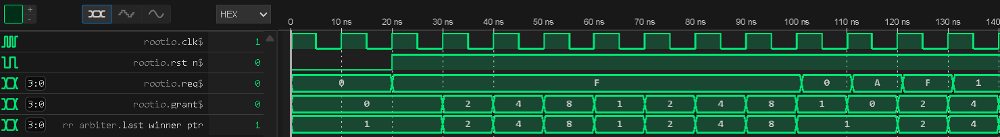

# Round-Robin Arbiter with C++ Co-Verification


## 📌 Project Overview
This project implements a **parameterized Round-Robin Arbiter** in SystemVerilog, verified using a **UVM-style Python testbench (Cocotb)** coupled with a **C++ Golden Model**.

The primary goal was to design a robust arbitration scheme that guarantees **fairness** and prevents **starvation** among multiple requesting agents (CPUs/IPs). The verification environment proves these properties mathematically by comparing RTL behavior against a bit-accurate software model cycle-by-cycle.

## 🛠️ Tech Stack
* **RTL Design:** SystemVerilog (Synthesizable)
* **Verification:** Python (Cocotb), `ctypes` library
* **Reference Model:** C++ (Bitwise logic using STL)
* **Simulator:** Verilator (Open Source)
* **Waveforms:** GTKWave

## 🧠 Design Architecture
The Arbiter uses a **Masked Priority Encoding** scheme rather than a simple counter. This ensures single-cycle decision latency and optimal timing paths for synthesis.

* **Fairness Logic:** Prioritizes requests cyclically based on the `last_winner_ptr`.
* **Masking Strategy:** Uses a "Thermometer Mask" generated via subtraction logic (`mask = ptr | (ptr - 1)`) to isolate higher-priority requests efficiently.
* **Wrap-Around:** If no requests exist above the current pointer, the priority wraps around to the LSB (Least Significant Bit).

## 🔍 Verification Strategy
The verification environment treats the RTL as a black box and validates it against a software "Source of Truth".

### 1. C++ Golden Model (`model/cpp/`)
Instead of duplicating logic in Python, a C++ model was written to simulate the arbitration using high-performance bitwise operations (`__builtin_ctz`). This mimics **DPI-C** workflows used in industry for processor verification.

### 2. Functional Coverage
We achieved **100% Functional Coverage** on the following critical bins:
* **Starvation Proof:** Verified that under full load (`req = 1111`), the grant rotates perfectly (0→1→2→3→0).
* **Input Scenarios:** Covered "No Request", "Single Request", and "All Requests".
* **Fairness Check:** Verified that every agent receives a grant at least once during stress testing.

## 📂 Repository Structure
```text
round-robin-arbiter/
├── rtl/
│   └── rr_arbiter.sv       # SystemVerilog Design (Masked Priority Logic)
├── model/
│   └── cpp/
│       └── arbiter_model.cpp # C++ Golden Model (Bit-accurate)
├── verif/
│   └── cocotb/
│       ├── test_arbiter.py   # Cocotb Testbench & Coverage Config
│       └── Makefile          # Automation for Verilator & C++ compilation
├── docs/                     # Waveforms and Diagrams
│   └── image_f63008.png      # Fairness Waveform Proof
└── README.md                 # Project Documentation
```

## 🚀 How to Run
The project includes a Makefile that handles C++ compilation and Verilator simulation automatically.

### Prerequisites
Python 3.x (with cocotb)

Verilator (v5.036+)

G++ (for model compilation)

### Execution
```bash
cd verif/cocotb
make
```

### Expected Output
```text
--- 🧪 PHASE 1: Checking Fairness (Starvation) ---
Sequence of winners: [1, 2, 4, 8, 1, 2, 4, 8]
✅ Fairness Verified: All agents got access under full load!
...
--- ✅ SUCCESS: Simulation & Coverage Complete ---
```

## 📈 Waveform Analysis
The waveform below demonstrates the "Fairness" property. When all agents request access simultaneously (req = 0xF), the grant signal rotates one position per clock cycle, ensuring zero starvation.


